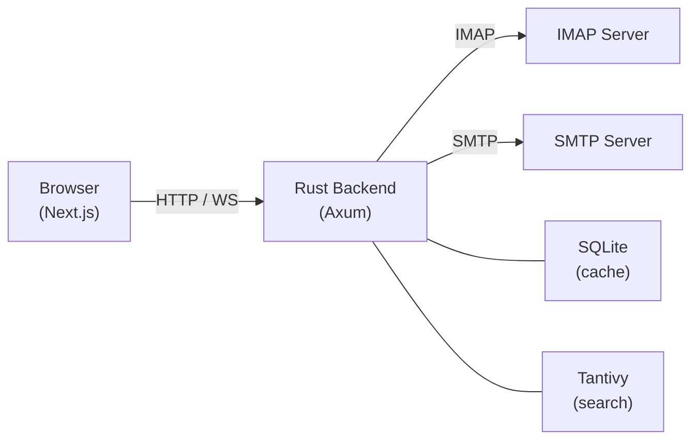

<div align="center">


# oxi

**Modern, fast, and secure open-source webmail client built with React + Rust.**

A feature-complete replacement for Roundcube that connects to any existing IMAP/SMTP mail server.\
Not a mail platform — just a clean, modern webmail UI.

[](https://github.com/c0h1b4/oxi/actions/workflows/ci-gate.yml)
[](LICENSE)
[](https://github.com/c0h1b4/oxi/stargazers)
[](https://github.com/c0h1b4/oxi/commits/main)
[](https://ghcr.io/c0h1b4/oxi)

</div>

---

<!-- Add a screenshot here:  -->

## Features

- **Mail** — Read, compose, reply, forward, and manage emails with a rich text editor (Tiptap)
- **Contacts** — Browse and manage your address book
- **Calendar** — iCal event parsing and calendar view
- **Full-Text Search** — Instant local search powered by Tantivy
- **Real-Time Updates** — WebSocket-driven live mailbox sync
- **Security** — IMAP credential auth, session tokens with configurable timeout, rate limiting
- **Fast** — Rust backend with per-user SQLite caching, static frontend served from the same binary
- **Self-Hosted** — Single Docker image, connects to any IMAP/SMTP server

## Tech Stack

| Layer | Technology |
|-------|-----------|
| **Frontend** | Next.js 16, React 19, Tailwind CSS 4, Shadcn/ui, Zustand, TanStack Query |
| **Backend** | Rust, Axum, Tokio, async-imap, Lettre (SMTP) |
| **Search** | Tantivy (Rust-native full-text search) |
| **Database** | SQLite per user (local cache via rusqlite + Refinery migrations) |
| **Editor** | Tiptap (rich text compose) |
| **Deploy** | Docker (GHCR), single binary serves frontend + API |

## Releases

**Current release: [v0.1.4 (Beta)](https://github.com/c0h1b4/oxi/releases/tag/v0.1.4).**
oxi now uses versioned releases. The 0.x series is beta software; breaking changes
may occur before 1.0. Back up persistent data before upgrading.

Use a versioned Docker tag for reproducible deployments. The `latest` image tracks
numbered releases; `edge` tracks `main` and can include unreleased changes.
See the [changelog](CHANGELOG.md) and [release process](docs/RELEASING.md).

## Quick Start

### Docker (recommended)

```bash
docker run -d \
  --name oxi \
  -p 3001:3001 \
  -e IMAP_HOST=mail.example.com \
  -e SMTP_HOST=mail.example.com \
  -v oxi-data:/data \
  ghcr.io/c0h1b4/oxi:v0.1.4
```

Or with `docker-compose.yml`:

```yaml
services:
  app:
    image: ghcr.io/c0h1b4/oxi:v0.1.4
    ports:
      - "3001:3001"
    environment:
      - IMAP_HOST=mail.example.com
      - SMTP_HOST=mail.example.com
    volumes:
      - oxi-data:/data

volumes:
  oxi-data:
```

Then open [http://localhost:3001](http://localhost:3001) and log in with your email credentials.

### Local Development

```bash
# Frontend
cd frontend && bun install && bun run build

# Backend
cd backend && cargo build --release

# Run (serves frontend + API on port 3001)
STATIC_DIR=../frontend/out IMAP_HOST=mail.example.com SMTP_HOST=mail.example.com \
  ./target/release/oxi-email-server
```

### Separate frontend and backend origins

For local hot reload, start the backend with `ENVIRONMENT=development`,
`SERVE_STATIC=false`, and `CORS_ORIGIN=http://localhost:3000`. Start the frontend
with `NEXT_PUBLIC_API_URL=http://localhost:3001/api bun run dev`.
`NEXT_PUBLIC_API_URL` is the complete API root, including `/api` and any backend
path prefix. It is a build-time value for static exports. API calls, attachment
previews/downloads, inline draft images, contact exports, and WebSockets all use
this root. Cross-origin fetches include session cookies.

Use the same hostname and scheme on both origins (different localhost ports are
fine). Development cookies are SameSite=Lax, so unrelated cross-site hosts are
not supported; production uses SameSite=Strict and should serve the frontend and
API from the same origin. Cookie/browser third-party policies still apply.

### Configurable subpath deployment (Docker)

Published images built with runtime-prefix support use **`BASE_PATH` at container
startup**. Use the same image for `/`, `/mail`, or a nested path such as
`/apps/mail`; no frontend rebuild is needed when changing the runtime prefix.
To test this implementation before a supporting image is published, build once
from this checkout (do not assume an older published tag contains this change):

```bash
docker build -t oxi:runtime-base-path .
docker run -d --name oxi -p 3001:3001 \
  -e BASE_PATH=/apps/mail \
  -e IMAP_HOST=mail.example.com -e SMTP_HOST=mail.example.com \
  -v oxi-data:/data oxi:runtime-base-path
```

Then open `https://mail.example.com/apps/mail/`. With the repository's Compose
file, set `BASE_PATH=/apps/mail` in `.env` or the shell before starting it.
Restart/recreate the container to change the prefix. Unset, empty, and `/` mean
the origin root. Trailing slashes are removed. Non-root paths must start with
`/`; each segment may contain ASCII letters, digits, `_`, and `-`. Empty interior
segments, dot segments, URL encoding, whitespace, queries, and fragments are
rejected at startup.

The reverse proxy must **preserve the prefix**, forward WebSocket upgrades, and
send all paths below it to Oxi. For example, with nginx (TLS configuration omitted):

```nginx
location = /apps/mail {
    return 308 /apps/mail/;
}
location /apps/mail/ {
    # No trailing URI slash: preserve /apps/mail/ in the upstream request.
    proxy_pass http://127.0.0.1:3001;
    proxy_http_version 1.1;
    proxy_set_header Host $host;
    proxy_set_header X-Forwarded-Proto $scheme;
    proxy_set_header Upgrade $http_upgrade;
    proxy_set_header Connection "upgrade";
}
```

Replace `/apps/mail` in the proxy configuration with your chosen `BASE_PATH`.
Assets, pages, API calls, auth cookies, redirects, notification icons, and
WebSockets stay under that prefix; no origin-root asset routes are required.

**Build-time versus runtime settings:** Next.js static export still bakes
`NEXT_PUBLIC_BASE_PATH` into its output. The Docker build sets it to the reserved
placeholder `/__OXI_BASE_PATH__`. At startup the Rust server resolves that
placeholder in a temporary copy of the frontend using `BASE_PATH`, including
Next.js router code and RSC payloads. The source assets remain unchanged, so
read-only container filesystems work when the temporary directory is writable
(for example, `--read-only --tmpfs /tmp` with a writable `/data` volume). Startup
fails if the temporary export cannot be created. Do not use the placeholder as
your deployment path or override the Docker frontend build setting.

Older images, including `v0.2.0`, do not have runtime-prefix support. Setting an
environment variable cannot retrofit those images; upgrade to a supporting image.
For custom fixed-prefix/local builds, continue to use the same value for
`NEXT_PUBLIC_BASE_PATH` at frontend build time and `BASE_PATH` at server startup.
These exports are served unchanged. See [Nix deployment](nix/README.md) for
fixed-prefix packages built automatically by the NixOS module.

## Configuration

All configuration is via environment variables:

| Variable | Default | Description |
|----------|---------|-------------|
| `HOST` | `0.0.0.0` | HTTP server bind address |
| `PORT` | `3001` | HTTP server port |
| `IMAP_HOST` | — | IMAP server hostname (**required**) |
| `IMAP_PORT` | `993` | IMAP server port |
| `SMTP_HOST` | — | SMTP server hostname (**required**) |
| `SMTP_PORT` | `587` | SMTP server port |
| `TLS_ENABLED` | `true` | Enable TLS for mail connections |
| `DATA_DIR` | `/data` | Persistent data storage directory |
| `SESSION_TIMEOUT_HOURS` | `24` | Session expiry in hours |
| `STATIC_DIR` | `./static` | Frontend static files directory |
| `ENVIRONMENT` | `development` | Runtime environment |
| `BASE_PATH` | empty (root) | Runtime URL prefix for Docker images (e.g. `/mail` or `/apps/mail`); fixed-prefix custom builds must match their frontend |
| `RUST_LOG` | `info` | Log level filter |

## Architecture



## Development

```bash
# Run frontend dev server (hot reload)
cd frontend && bun run dev

# Run backend
cd backend && cargo run

# Run tests
cd frontend && bunx vitest run
cd backend && cargo test

# Lint
cd frontend && bun run lint
cd backend && cargo clippy -- -D warnings
```

## Roadmap

oxi is under active development. Core email functionality (read, compose, search, contacts, calendar) is implemented. Coming next:

- Sieve filter support
- Attachment previews
- Keyboard shortcuts
- Theme customization
- Multi-account support

## Contributing

Contributions are welcome! Please:

1. Fork the repository
2. Create a feature branch (`git checkout -b feat/my-feature`)
3. Commit your changes
4. Open a pull request against `main`

## License

[MIT](LICENSE)

---

<div align="center">

## Star History

[](https://star-history.com/#c0h1b4/oxi&Date)

</div>
